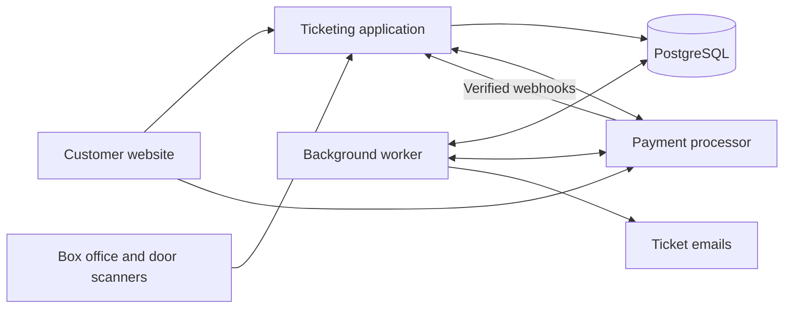

I’d build **one web application backed by PostgreSQL**, with a payment processor for cards and a phone-friendly scanner for volunteers. For a 300-seat venue, the difficult part is keeping seat reservations, payments, and admission consistent when requests happen simultaneously.

You would own the ticketing experience and customer records. Card-processing fees, hosting, and maintenance would remain.

I’ll assume guests can buy without an account, each performance has its own inventory, and tickets allow one admission per seat.

The application and worker can share one codebase. Use managed hosting and a managed database to reduce volunteer maintenance.

**Make the database the authority for every seat.** The seating map is a view of availability; successfully reserving seats is what guarantees them.

The main records would be:

| Record | Key information |
|---|---|
| Seat | Row, number, map position, accessibility attributes |
| Performance | Show, date, sale opening time, seating layout |
| Performance seat | Performance + seat, price, availability, current reservation |
| Reservation/order | Selected seats, buyer, total, expiry, payment status |
| Payment | Order, processor reference, amount, currency, status |
| Ticket | One seat, random QR token hash, validity, admission status |
| Delivery and audit records | Pending emails, payment events, staff actions |

Enforce one inventory row per `(performance, seat)` and at most one active ticket for that inventory row. Keep historical orders and voided tickets.

The purchase flow would work like this:

1. **Browse.** Display an accessible seating map with a keyboard-operable list alternative. Show prices, accessible spaces, selected seats, and the total.
2. **Reserve.** When the customer proceeds, reserve their entire selection for ten minutes. In a short database transaction, lock the requested seat rows in a consistent order, verify availability, and reserve all of them or none.
3. **Pay.** Calculate prices on the server and initiate the card payment against that reservation.
4. **Confirm.** Once the backend verifies successful payment, mark the seats sold and create one ticket per seat.
5. **Deliver.** Display tickets on the confirmation page and email a printable copy. Email failure must not invalidate the purchase.

PostgreSQL row locks let competing requests serialize access to the same seats. If two customers request A12, one reservation succeeds; the other receives an availability conflict and an updated map. Hold these locks only during database work, never while calling the payment provider. [PostgreSQL locking documentation](https://www.postgresql.org/docs/current/explicit-locking.html)

**Payment and reservation expiry need a shared workflow.** This is the most important implementation detail.

Use provider-hosted card fields, such as Stripe’s Payment Element, so card numbers go directly to the processor. That reduces your payment-security scope, although it does not remove your responsibilities. A custom payment flow can use Payment Intents to coordinate with the reservation lifecycle. [Stripe integration security](https://docs.stripe.com/security/guide), [Payment Element documentation](https://docs.stripe.com/payments/payment-element)

Before creating a payment, durably mark the order as payment pending. Use a stable idempotency key so a timeout or repeated click cannot create multiple payment objects. Keep database transactions separate from external calls, and make interrupted steps recoverable.

At the ten-minute deadline:

| Payment situation | Action |
|---|---|
| No payment was initiated | Release the seats |
| Payment exists and can be canceled | Confirm cancellation, then release |
| Payment succeeded | Complete the order and issue tickets |
| Payment is processing or its outcome is unknown | Keep the seats reserved and reconcile |

**Never release seats merely because the countdown reached zero while payment might still succeed.** Cancellation can race with payment, and some processing states cannot be canceled. The worker must resolve the provider’s actual state before releasing inventory. Customers may briefly see “Payment being confirmed.” [Stripe cancellation behavior](https://docs.stripe.com/api/payment_intents/cancel)

Payment confirmation should use verified server-side information, checking the order reference, amount, currency, and successful payment status. The customer’s browser redirect is only a status page.

Persist incoming webhook events before acknowledging them, tolerate duplicates and out-of-order delivery, and make fulfillment idempotent: repeat notifications cannot create additional tickets. Record ticket creation and a pending email job in the same transaction, then send email asynchronously. A reconciliation job should recover payments whose webhook was missed. [Stripe webhooks](https://docs.stripe.com/webhooks), [payment status verification](https://docs.stripe.com/payments/payment-intents/verifying-status)

**Each ticket should have its own QR code.** Encode an unguessable random token, with no customer details, and store its hash in the database. Show the performance, row, and seat as readable text beside it.

Volunteers use an authenticated scanner website on their phones. For each scan, the server checks the selected performance, ticket validity, and admission status, then atomically marks an unused ticket admitted.

That produces three clear results:

- **Green:** admitted; display row and seat.
- **Amber:** already admitted; display the original scan time.
- **Red:** invalid, voided, or for another performance.

Two doors scanning the same ticket simultaneously must produce only one admission. Give scan requests an idempotency key so retrying after a lost response returns the original result.

Use online scanning with venue Wi-Fi and a mobile hotspot backup. **Independent offline scanners cannot reliably prevent duplicate admission across doors.** For an outage, use a supervised manual entrance with a downloaded door list and record exceptions for reconciliation.

**Plan for the opening-minute burst, rather than the hourly sales average.** Selling 300 seats in an hour says little about how many people arrive at opening time.

Cache show pages and the static seating layout. Refresh availability every few seconds with staggered polling; always recheck inventory during reservation. As an illustrative load test, 1,000 browsers polling every five seconds generate about 200 availability requests per second, before checkout traffic.

Limit reservation size and active holds per session, prevent unlimited timer extensions, and rate-limit abusive reservation requests. Enforce sale opening time on the server. Add a waiting room if measured demand exceeds tested capacity. Seat ownership should remain in PostgreSQL even if caching is added later.

The first release also needs practical box-office tools:

- Create performances, set prices, block seats, and issue complimentary tickets through the same inventory rules.
- Find orders, resend tickets, and record refunds.
- Reissue a ticket by invalidating its previous QR token.
- Explicitly decide whether a refunded seat returns to sale.
- Separate scanner permissions from refund and administration permissions; require MFA for administrators.
- Provide sales, payment-reconciliation, and attendance reports.

Before launch, test the failures that could spoil a performance: simultaneous reservations for the same seats, partial-cart conflicts, payment success at expiry, lost payment responses, duplicate webhooks, email outages, and simultaneous scans at different doors. Also test a database restore and rehearse admission with the volunteers.

Assign named maintainers, enable managed backups and alerts for unresolved payments, and run a small invited sale before the first popular show. That gives you a manageable system whose central guarantees are clear: **one owner per seat, recoverable payment handling, and one admission per ticket.**