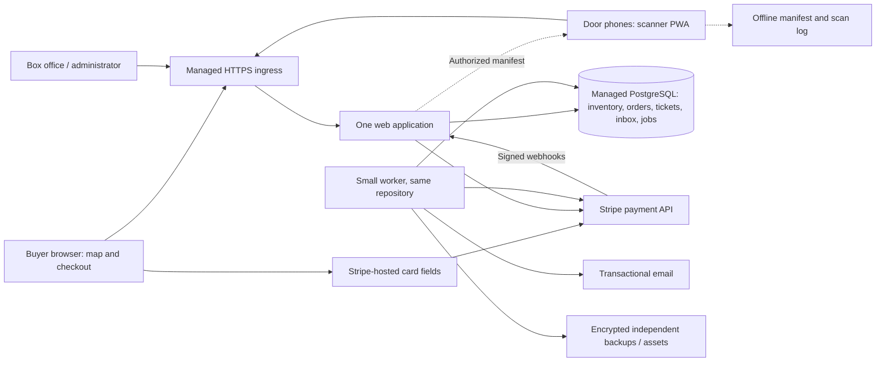

# Community theater ticketing system

One web application and a small worker share managed PostgreSQL; Stripe handles cards, and a browser scanner checks individual QR tickets.
Budget: approximately A$90/month expected, A$120/month planning allowance, excluding card fees, development, and volunteer time.
Main risk: a payment completing near reservation expiry; seats remain reserved while capture is unresolved.
Confirm before implementation: ticket identity and QR format, seat-history model, payment contract, offline admission policy, and retention promises.

## 1. Requirements and numbers

### Confirmed requirements

| Area | Requirement |
| --- | --- |
| Venue | One 300-seat venue; numbered seats selected on a map; tickets are performance-specific. |
| Demand | 100 performances/year; 500 simultaneous buyers; one performance opens for sale at a time. Popular performances sell out within an hour. |
| Checkout | Guest checkout; eight-minute holds; maximum six seats/order; card payments in AUD in Australia. |
| Operations | Box-office sales, complimentary tickets, refunds, exchanges, and staff-controlled accessible seats use the same inventory. |
| Entry | Email tickets, one QR per seat; 2–4 phones; normal entry is single-use, with staff-controlled re-entry. Wi-Fi and a hotspot are available; admission must continue through temporary internet outages. |
| Reliability | Prefer an outage to risking lost confirmed bookings; one-hour recovery target. |
| Resources | A$150/month operating ceiling excluding card fees; volunteer developer, occasional maintenance. |

Additional sizing assumptions, not new requirements: all performances sell out for the annual upper bound; two seats per paid order; three hold attempts per successful order; 500 browsing sessions/performance, each polling for ten minutes; 2% refunds and 1% exchanges. Timeouts and limits below are adjustable. No resale, customer accounts, multi-venue support, or separate marketing system initially.

### Workload arithmetic

Annual capacity = `300 × 100 = 30,000 tickets`; paid-order upper bound at two seats/order = `30,000 / 2 = 15,000 orders`. Real paid volume falls when seats go unsold or are complimentary. Use `365 × 86,400 = 31,536,000 seconds/year` for averages. Sellout throughput alone is tiny: `150 orders / 3,600 seconds = 0.042 orders/s`; contention is driven by people trying for the same seats.

The following peaks are sizing envelopes, not inferred measurements. Read and write counts exclude static assets and internal job bookkeeping.

| Main operation | Annual volume and average rate | Peak envelope | Database reads and writes |
| --- | --- | --- | --- |
| Seat map | `100 × 500 × (600/5 + 1) = 6.05M reads`; `6.05M / 31.536M = 0.192/s` | `500 / 5 s = 100 reads/s`; initial refresh bursts tested separately | One indexed read of at most 300 rows; zero writes. |
| Hold attempt | `15,000 × 3 = 45,000`; `0.00143/s` | 50 attempts/s sustained; also test 500 submitted together | One locking inventory read, up to six seats; successful transaction writes order, lines, and inventory. A conflict writes only its idempotency outcome. |
| Order status | `15,000 × 5 = 75,000 reads`; `0.00238/s` | `50 pending buyers / 2 s = 25 reads/s` | One indexed order read; zero writes. |
| Payment finalization | `15,000`; `0.000476/s` | 10 orders/s, potentially selling all 300 seats in 15 seconds | Short allocation and completion transactions; up to six seat/ticket rows each. Two external operations/order: authorization and capture, thus 30,000/year and up to 20/s combined. |
| Payment webhooks | `15,000 × 3 = 45,000 events`; `0.00143/s` | 30 events/s | Unique inbox insert, followed by indexed processing reads and conditional state writes. |
| Ticket viewing/printing | `30,000 × 1.5 = 45,000 requests`; `0.00143/s` | 20 reads/s | Order/ticket reads, no inventory writes; render QR/PDF as needed. |
| Door admission | `30,000 scans`; `0.000951/s` | `4 phones / 2 s = 2 scans/s`; 300 in 30 minutes averages 0.167/s | Indexed ticket read, conditional check-in write, and audit insert. |
| Delivery jobs | `15,000 × 1.5 = 22,500 emails`; `0.000713/s` | Drain at 5 emails/s, subject to provider quota | Read a job and ticket data; record delivery result. One email may carry up to six tickets. |
| Refund / exchange | `300 / 150 per year`; `0.00000951 / 0.00000476 per second` | Allow one of each/s | Lock affected tickets/seats; write ledger and ticket changes; payment calls outside transactions. |
| Performance setup | 100 publications/year; `30,000 inventory rows/year` | Publish one 300-seat performance in a background transaction | Layout reads and inventory inserts, outside the buyer hot path. |

At peak, polling delivers `100 × 5 KB ≈ 500 KB/s` compressed seat snapshots. It does not send a message per seat change to every browser. Annual map transfer is approximately `6.05M × 5 KB ≈ 30 GB`, plus approximately `50,000 sessions × 0.5 MB ≈ 25 GB` for pages/posters. This is modest bandwidth. Poll only while the map is visible; add jitter, back off after sellout, and return a fresh snapshot after reconnecting. Maps are advisory; the reservation transaction decides ownership.

### Storage per year

Decimal units, approximate sizes before indexes. Retention means some categories do not accumulate indefinitely.

| Data type | Annual arithmetic | Storage policy |
| --- | --- | --- |
| Performance inventory | `30,000 × 0.25 KB = 7.5 MB` | Keep seat identity and layout snapshots with historical orders. |
| Confirmed orders and lines | `15,000 × 1.5 KB + 30,000 × 0.4 KB = 34.5 MB` | Durable financial and allocation history. |
| Checkout attempts | `45,000 × 1 KB = 45 MB` | Conservative additional allowance; remove abandoned contact data after 30 days. |
| Tickets | `30,000 × 0.5 KB = 15 MB` | Keep identity, issuance/revocation history; expire admission eligibility after performance. |
| Payment ledger and webhook bodies | `15,000 × 2 KB + 45,000 × 2 KB = 120 MB` | Ledger retained; redact and delete raw webhook bodies after 30 days. |
| Admissions | `30,000 × 0.3 KB = 9 MB` | Delete identifying scan detail after 90 days; retain aggregate attendance. |
| Audit and jobs | `100,000 × 0.5 KB + 45,000 × 0.5 KB ≈ 73 MB` | Audit financial actions; prune completed delivery jobs after 30 days. |
| Operational logs | `about 6.5M requests × 0.5 KB ≈ 3.25 GB/year` | Outside database, rolling 30 days, approximately 270 MB live; omit tokens and personal information. |
| Posters/layout assets | `100 × 0.5 MB = 50 MB/year` | Object storage or versioned static assets. |
| Printable PDFs | `30,000 × 50 KB ≈ 1.5 GB/year` if persisted | Generate on demand; email copies need no permanent duplicate in application storage. |

Allow **1 GB/year of database growth** including indexes, overhead, and uncertain audit volume. Reserve 5 GB initially; measure real write-ahead-log volume for the recovery window. Encrypted exports and retained backup versions are additional storage, budgeted separately.

### Monthly cost

Concrete implementation option, with official prices checked 24 October 2026. USD conversion uses a **planning factor of A$1.60/US$1**, not a live exchange quote. Tax is a 10% planning allowance, not a tax determination. No introductory credits are assumed.

| Item | Arithmetic / allowance | US$/month |
| --- | --- | ---: |
| Managed web application | DigitalOcean App Platform, one shared vCPU / 1 GiB | 12.00 |
| Worker, same codebase | Separate 512 MiB component | 5.00 |
| Managed PostgreSQL | Neon Launch; `0.25 CU × 730 h × $0.106`, plus `0.75 extra CU × 50 busy h × $0.106` | 23.32 |
| Database storage | `5 GB × $0.35` | 1.75 |
| Continuous recovery history | Budget `5 GB retained WAL × $0.20` | 1.00 |
| Independent encrypted backup/assets | Storage and request allowance | 2.00 |
| Transactional email | `22,500 / 12 / 1,000 × $0.10`, rounded for data | 0.19 |
| Domain and monitoring | Monthly allowances: $2 + $3 | 5.00 |
| **Expected infrastructure** | **Total** | **50.26** |

`US$50.26 × 1.60 × 1.10 ≈ A$88.46/month`; round to **A$90 expected**, with an **A$120 planning allowance** and A$150 ceiling. Compute usage and exchange rates are variable. Alert at A$100 forecast and review at A$120; never automatically shut off the booking database to enforce a cost cap. Persistent high CPU needs a revised estimate. Dedicated staging is temporary and must use synthetic data.

App component prices and regional availability: [DigitalOcean pricing](https://docs.digitalocean.com/products/app-platform/details/pricing/), [Sydney availability](https://docs.digitalocean.com/products/app-platform/details/availability/). Database rates and seven-day history support: [Neon pricing](https://neon.com/pricing). Email rate: [Amazon SES pricing](https://aws.amazon.com/ses/pricing/).

Card fees remain even with your own ticketing site. Stripe currently lists **1.65% + A$0.30 for domestic online cards**, and 3.5% + A$0.30 for international cards. Illustratively, a two-ticket A$70 domestic order costs approximately A$1.46 to process. If all 30,000 seats sold at A$35 in 15,000 domestic-card orders, processing would average `(30,000 × 35 × 0.0165 + 15,000 × 0.30) / 12 = A$1,818.75/month`, outside hosting. Refunds, disputes, international cards, hardware, development, and maintenance can add costs. [Stripe Australia pricing](https://stripe.com/au/pricing).

## 2. Architecture

Use a conventional monolith in the maintainer's strongest supported framework; Django with PostgreSQL is a reasonable default. Serve the map as SVG with a keyboard-accessible seat list. A small progressive web app provides camera scanning and local storage. Public pages/assets may be cached; checkout, ticket pages, manifests, and admission responses use `Cache-Control: no-store`. No customer booking data enters a shared cache.



Deploy web and database in Sydney; both providers list Sydney support. [Neon regions](https://neon.com/docs/introduction/regions). Use TLS for their network connection, short transactions, and a bounded connection pool of approximately 10 web + 5 worker database connections. Start database compute at 0.25 CU, bounded autoscaling to 1 CU. Keep it awake: worker polling already prevents idle sleep, so budget an always-on baseline.

The worker reads a PostgreSQL job table; webhooks first enter a durable inbox. Jobs use leases and `FOR UPDATE SKIP LOCKED`, with no network call while holding a database transaction. Delivery, reconciliation, exports, PDF attachments, and expired-attempt cleanup do not delay a buyer's request. Capture is required for checkout completion and is a priority job; the browser polls status while it runs. No Redis, external message broker, Kubernetes, or microservices are needed at these numbers.

Capacity is an estimate pending implementation: test 500 browsers, 100 map reads/s, 50 hold attempts/s, 10 checkout completions/s, and 2 scans/s together. Also submit 500 simultaneous requests for the same few seats. Target p95 under one second for map/hold/online scan, bounded conflict responses within five seconds for the collision burst, and under five seconds from card authorization to confirmation when dependencies are healthy. Run once at twice the sustained envelope. Choose a larger app/compute size if measurements require it; don't assume a small shared CPU guarantees a throughput figure.

## 3. Data model

Amounts are integer AUD cents; timestamps are UTC, displayed in the venue's configured IANA time zone. Browser clocks never determine expiry. Internal/public entity IDs use UUIDv4; guest order access additionally requires a separate random, revocable 256-bit secret stored as a hash.

| Table | Essential fields and constraints |
| --- | --- |
| `layout_version`, `seat` | Immutable published layout version; stable seat ID, row/number, map coordinates, zone, accessibility designation. Physical changes create a new version. |
| `performance` | Show/title, start time, sale opening/closing times, layout version, pricing version, publication/cancellation state. |
| `performance_seat` | **PK `(performance_id, seat_id)`**; price snapshot, state, holding order, hold expiry, allocation ID. Composite foreign keys enforce the performance/layout relationship. |
| `order`, `order_line` | Guest email, state, total, currency, expiry, source; immutable purchased seat/label/price snapshots. Lines link to the exact inventory row and allocation. |
| `payment` | Order ID, unique provider intent ID, authorized/captured/refunded cents, status; at most one canonical intent per order. Store no PAN or CVC. |
| `ticket` | UUID, performance/seat/order-line references, issuance version, status, checked-in timestamp. Partial unique index on `(performance_id, seat_id)` for tickets in `ACTIVE` or `SUSPENDED` state. Reissue revokes old ticket before inserting new. |
| `admission_event` | UUID, ticket, device, mode, result, staff actor, server time and optional client time. Unique `(device_id, client_scan_id)` for retry/offline deduplication. |
| `mutation_request` | Unique `(principal_or_guest_session, operation, idempotency_key)`, request hash, durable result reference. Reject same key with a different payload. |
| `webhook_inbox`, `job` | Provider event ID unique; processing state, attempts, next attempt, lease expiry, last error. Job effect key unique, such as `email:order:version`. |
| `adjustment`, `audit_event` | Refund/exchange/comp IDs, payment references, actor, reason, immutable amount and inventory changes. |

Inventory states: `AVAILABLE → HELD → CAPTURING → SOLD`; `HELD → AVAILABLE` on expiry; `CAPTURING → AVAILABLE` only after verified payment failure/cancellation. `BLOCKED` reserves house/accessibility inventory. `STAFF_PENDING` is a non-expiring, staff-owned allocation for external terminal/cash collection; staff reconcile the receipt before selling or releasing it. Confirmed refunds revoke tickets before making seats available. Constraints require owner/expiry for `HELD`, an owner and no expiry for `CAPTURING` or `STAFF_PENDING`, and an allocation for `SOLD`.

### Hot-path query and indexes

The hold endpoint requires 1–6 distinct seat IDs for one performance and a request idempotency key. Inside one transaction:

```sql
SELECT performance_id, seat_id, state, holding_order_id, hold_expires_at
FROM performance_seat
WHERE performance_id = $1 AND seat_id = ANY($2)
ORDER BY seat_id
FOR UPDATE;
```

The composite primary-key index serves this query and the whole-map lookup by `performance_id`. Lock every requested row before evaluating availability; require exactly the requested count. Under the lock, accept only `AVAILABLE` or expired `HELD` rows, enforce sales/access rules, calculate prices server-side, and update all seats plus the order/lines atomically. Use database `clock_timestamp()` after acquiring locks to evaluate deadlines. Roll back the entire reservation on any conflict and return HTTP 409. A sold/capturing/blocked/staff-pending seat is never reclaimable by expiry.

All inventory operations lock seats in the same `(performance_id, seat_id)` order, then any existing orders in ID order. Short lock/statement timeouts and bounded retries prevent a hot seat from tying up the whole connection pool. PostgreSQL row locks serialize conflicting updates; ownership is decided in the transaction, never by a prior availability read. [PostgreSQL locking](https://www.postgresql.org/docs/current/explicit-locking.html).

Additional indexes: `performance_seat(hold_expires_at) WHERE state = 'HELD'`; `order(state, updated_at)` for reconciliation; `job(next_attempt_at) WHERE state = 'READY'`; unique webhook event and payment intent IDs; ticket PK for scans. Role checks apply even when staff know a seat or ticket UUID. Cross-table allocation/ticket transitions use the same transaction; uniqueness constraints backstop duplicate admission rights.

## 4. Key flows

### A. Hold, authorize, capture, issue

1. Buyer selects seats and requests a hold. The transaction above holds all requested seats for eight minutes, snapshots the price, and records the idempotent result. Merely clicking a seat on the map does not hold it. A rejected request prompts a refreshed map.
2. Persist an intent-creation job with the order; create a Stripe PaymentIntent with `capture_method=manual`, only eligible card methods, fixed server-calculated amount/currency, and a stable key `intent:<order-id>`. A short synchronous attempt can make checkout ready quickly; the worker resumes after a crash. Persist the intent ID before exposing its client secret. Card data goes directly from Stripe's hosted fields to Stripe.
3. The buyer authorizes the card, including bank authentication. An authorization is a temporary bank hold, not a confirmed ticket purchase. A browser return merely asks the server to check progress; it is never proof of payment. Stripe supports separate authorization and capture, with `requires_capture` identifying an authorized payment. [Stripe manual capture](https://docs.stripe.com/payments/place-a-hold-on-a-payment-method).
4. Verify the provider's current intent state, merchant account, amount, currency, and canonical order association. Then lock the requested inventory and order. If the order is already `CAPTURING` or paid, return/resume its existing workflow without canceling or expiring it. Only an order still in `HELD` may proceed: if every requested seat is still held by this order and the deadline has not passed, atomically change seats and order to `CAPTURING`, remove expiry, and enqueue one capture job. Otherwise expire the unpaid hold and cancel its authorization. Never capture a late authorization for reclaimed seats. Cancellation jobs recheck durable order state and must not cancel a pinned or paid workflow.
5. The worker captures using a stable key `capture:<order-id>` outside the transaction. On verified success, one transaction marks the order paid, marks seats sold, inserts one ticket per seat, and enqueues email. The confirmation page becomes available immediately after this commit; email delivery can follow.
6. If capture times out or its result is unknown, keep the seats in `CAPTURING`. Query the same intent until success or definitive cancellation/failure. Alert after five minutes; never release merely because a timer elapsed. Once confirmed canceled, release seats transactionally. If a capture happened before the worker crashed, reconciliation issues the existing order's tickets exactly once.

This is a recoverable workflow across PostgreSQL and Stripe, not a distributed transaction. It favors temporary unavailability of a few seats over double-selling. Do not manually capture or cancel payments in Stripe's dashboard during routine operations; use audited application actions. Unexpected dashboard charges go to a reconciliation exception, never to a second seat allocation.

Expired holds can be reclaimed directly by the hold transaction; a sweeper every 15 seconds only improves housekeeping. At the exact eight-minute boundary, finalization and reclamation lock the same inventory rows, so one wins. If bank authentication takes too long, explain that the reservation expired and void the authorization; cancellation can take time to disappear from a bank statement. No silent extension on page refresh. Countdown uses server expiry and an accessible warning.

### B. Retries and background processing

Verify webhook signatures against the unmodified request body. Acknowledge only after durable inbox insertion; return an error if the database is unavailable. Workers retrieve current provider status rather than applying old events blindly. Webhook delivery can be duplicated and unordered. [Stripe webhook delivery behavior](https://docs.stripe.com/webhooks).

Application mutation keys, provider keys, state guards, and unique constraints have separate roles. Retrying an intent creation must reuse the original parameters; after a long unknown result, locate the original using stored identifiers/metadata and reconcile rather than blindly creating another. Stripe supports idempotent API requests, but permanent business deduplication remains in our database. [Stripe idempotency](https://docs.stripe.com/api/idempotent_requests).

Lease jobs for 60 seconds and renew long work. Retry transient failures with jittered exponential delays, capped at five minutes. After ten failures flag a visible exception and alert; retain the work. Unresolved financial operations remain under reconciliation every minute until terminal, including after a job is flagged. Capture/reconciliation outrank email and exports. An email may be delivered twice after an ambiguous provider response, but carries the same tickets. No background job may create new admission rights merely because it retried.

### C. Tickets and online entry

Use a signed, versioned QR payload with `format_version, key_id, ticket_id, performance_id, seat_id, issuance_version`, signed with Ed25519 through a maintained library. No email or name in the code. Signing key stays server-side; phones receive public verification keys. Retain public keys until the last associated performance has ended. QR format is a compatibility contract, with test fixtures for printed tickets and scanners.

An authenticated scanner checks the selected performance, signature, ticket status/version, and then performs a conditional update: `UPDATE ticket SET checked_in_at = clock_timestamp() WHERE id = ? AND status = 'ACTIVE' AND checked_in_at IS NULL RETURNING id`. Record the scan request and result in the same transaction. Exactly one concurrent first scan succeeds; a retry with the same scan ID and payload returns its original result. Reject reuse of a scan ID for a different ticket. A different scan of an admitted ticket shows its earlier admission. Wrong-show, revoked, and unknown codes are visibly rejected. Staff receive seat/row and a simple accepted/already used/rejected result.

QRs are bearer credentials: a copied screenshot can be used first. Signing prevents fabrication, not copying. Resending an email reuses the ticket. Authorized reissue revokes the old ID and generates a new ticket. Supervisors may explicitly override re-entry with an audited reason; ordinary scanner staff cannot refund, reissue, or clear admission history.

### D. Internet outage at the door

Before doors open, install/cache the scanner app, authenticate the phones, download a signed manifest of active tickets, revocations, verification keys and known admissions, and record its version/time. Refresh local state every two seconds while online. Keep successful scans and pending scan UUIDs durably on the device before showing success. A manifest is about `300 × 0.5 KB = 150 KB` plus small logs.

On lost connectivity, switch to the hotspot first. If unavailable, the duty manager stops other lanes and designates **one phone for all offline admissions**. That phone verifies against the cached manifest and rejects repeat scans recorded locally. Other staff direct the queue and handle manual exceptions. Pause sales, refunds, exchanges and reissues at the venue during offline operation; attempt to pause remote mutations as well. A printed minimal seat/ticket roster is a last-resort fallback if the phone fails.

**Offline acceptance is provisional.** A disconnected device cannot know a recent cloud refund, reissue, sale, or admission on another phone. Even a single offline phone can have stale information from the last sync; staff must handle unknown tickets and conflicting admissions. If remote mutations cannot be stopped, their results may be absent. Do not advertise globally guaranteed single-use admission during a network partition. Multiple independent offline scanners would make this risk substantially worse.

On reconnection, keep other lanes paused while uploading pending events idempotently and refreshing the manifest. Merge events without overwriting earlier server admissions; flag conflicts for the supervisor. Resume normal lanes only after sync completes. Test browser storage persistence and camera behavior on the actual phones; a device replacement requires an explicit handover of its scan log, or supervised manual admission.

### E. Box office, refunds, exchanges, administration

| Operation | Behavior |
| --- | --- |
| Box office | Uses the same hold and allocation transactions. Card sales can use the same buyer-facing card form on a venue device. A standalone card terminal/cash receipt can be linked by staff with a unique external receipt ID; use a non-expiring pending allocation before taking that external payment. An abandoned/unknown payment requires staff reconciliation before release. Integrated Terminal support is a later option. No offline sales against a disconnected inventory. |
| Complimentary / house seats | Staff permission and reason required; zero-price allocation and ticket creation commit together. Accessible inventory is staff-controlled, clearly described, and obtainable by a published contact method. |
| Refund | Lock eligible, unadmitted tickets/seats; mark tickets suspended and seats retained, persist refund adjustment/job. Call provider idempotently. On success revoke tickets, record ledger adjustment and release seats atomically. On unknown/failure, keep reserved and show an exception; never report success before confirmation. A supervisor decides any refund after admission. |
| Exchange | Equal-price exchanges lock old and new seats together, allocate replacement, revoke old ticket and issue new ticket atomically. For a price change, use a linked replacement purchase followed by an original-ticket refund, with the old seat reserved during the workflow. A failed replacement leaves the original valid; after replacement success, original suspension/refund uses the preceding flow. Record the relationship and warn about temporary overlapping card charges. |
| Cancel performance | Stop sales first; persist one adjustment/job per paid order with progress. Batch refunds are restartable, show unresolved cases, and respect provider limits. Notify complimentary holders separately. |
| Administration | Admins publish shows/prices and manage staff; box office sells/adjusts; scanners admit; supervisors override. Require MFA for privileged accounts and audit all financial/inventory changes. Published seat identities cannot be edited in place. |

Refunds and exchanges must recheck admission eligibility while holding the affected ticket row locks; scanning and ticket suspension/revocation serialize on those rows. A price-change exchange is two linked purchases/refunds rather than an atomic money transfer: staff must resolve an intervening admission or refund failure visibly, without silently invalidating an admitted original ticket. At gate time, assign one duty manager to coordinate refunds/reissues and lane-mode changes; software cannot resolve disconnected staff making contradictory decisions.

## 5. Data protection

RPO means how much recent data might need recovery; RTO means time to restore service. Target **99.9% monthly availability** (about 43 minutes unavailable in a 30-day month), an internal objective rather than a purchased end-to-end SLA. Ordinary component failure RTO is **at most one hour**, with managed restarts expected sooner and a duty volunteer reachable during launches/performances.

| Data type | Cost to lose it | RPO | Mechanism |
| --- | --- | --- | --- |
| Confirmed orders, allocations, captured-payment ledger, ticket revocations | Financial loss and conflicting claims on seats; irreplaceable | **0 committed transactions for app/compute or one-AZ failure** | Durable PostgreSQL commits using the provider's quorum storage; continuous seven-day PITR; no success response before commit. Independent provider payment ledger supports reconciliation, not a complete seat backup. |
| Admission records | Possible duplicate entry; irreplaceable during the event | Online: same as database above; offline: survives app restart, but a destroyed device can lose unsynced events | Atomic online scan records; durable local offline log; sync every two seconds while connected; printed fallback/manual audit. |
| Holds / unpaid checkouts | Buyer inconvenience | May expire during recovery | Database state plus server deadlines. On restore, expire stale unpaid holds; preserve unresolved captures until reconciled. |
| Layouts, prices, show content | Manual reconstruction and booking errors | Published records: same database protection; static media: 24 hours | Versioned layouts and immutable order snapshots; source control/static assets and encrypted export. |
| Signing keys, credentials, recovery codes | Inability to operate or validate old tickets | 0 acknowledged key changes | Organization-owned secret store plus separately encrypted recovery copy; public verification keys distributed to scanners. |
| Delivery jobs and webhook inbox | Missing emails or payment completion | Same as committed database; recoverable by reconciliation | Transactional job insertion; durable inbox; delivery resend and provider reconciliation. |
| Aggregate analytics / operational logs | Lost diagnostics | 24 hours / 30-day retention | Rebuild from retained financial events where possible; log export. |

Neon documents quorum-acknowledged commits and multi-AZ storage; compute failover still causes temporary disconnections. Those properties support the zero-loss **component-failure target**, not an unlimited zero-loss promise. [Commit durability](https://neon.com/docs/introduction/architecture-overview), [availability and regional limitations](https://neon.com/docs/introduction/high-availability). Configure the paid plan's recovery history to seven days explicitly; its default is shorter. PITR is continuous, unlike a nightly-only backup. [Recovery mechanism](https://neon.com/docs/postgres/backup-restore/backups), [history configuration and cost](https://neon.com/pricing).

Export an encrypted consistent database snapshot hourly into a separate organization-owned storage account in Melbourne, retain hourly copies for 48 hours and daily copies for 30 days, and use a separate credential for backup deletion. **Complete region/account loss has an independent-backup RPO up to one hour plus export lag, and no guaranteed one-hour RTO.** An overdue backup alerts; the actual recoverable timestamp must be visible. This is the residual risk at this budget, and must be accepted before implementation. Strict zero loss across regional/account disasters would require continuous independent replication and a larger operating commitment.

Quarterly, restore to an isolated database, verify paid-seat/ticket/payment consistency, and record recovery duration. Before a season, rehearse loss of the web instance and a full PITR recovery. For a restore, stop all writes and workers, fence off the old database, restore into a new target, reconcile every affected provider intent/refund, quarantine uncertain seats, then reopen. Never resume selling from a stale snapshot before reconciliation. PITR restores to before an accidental deletion must recover valid later transactions too, not silently discard them.

Personal data: retain only necessary contact details; encrypt transport/backups; keep guest access tokens, card secrets and QR credentials out of logs and URLs sent to analytics. Separate revocable guest access from ticket QR credentials. Use a proposed seven-year minimum financial ledger, 90-day admission detail, 30-day raw webhook/log retention, and removal of contact details 90 days after the performance unless needed for an unresolved case. These are proposed product promises, subject to the theater's accountant/privacy review, not assertions of legal retention duties. Backup expiry can delay physical deletion by up to 30 days; document this. Stripe-hosted fields reduce card-data exposure; the theater must still complete the provider's applicable merchant security process.

## 6. Decisions

“Hard to reverse” means a future change requires a data migration, invalidates an external artifact, or changes a customer promise. Resource sizes, hold duration, polling intervals and limits are configuration.

| Choice | Alternative | Why | Hard to reverse? |
| --- | --- | --- | --- |
| Versioned seat identities and one inventory row per performance/seat | Store a mutable seating JSON document and counters | Exact seat ownership, historical receipts and database constraints | **Yes:** migrate bookings and preserve old seat labels/layouts. |
| UUID ticket IDs; signed QR v1 with key ID and no PII | Opaque online-only token, or ticket URLs carrying order access | Allows local signature checks and performance scoping without exposing contact data | **Yes:** support old printed tickets and scanners through their last performance. |
| Stripe, AUD cents, one canonical manual-capture intent per order | Automatic charging followed by refunds after a seat race | Avoid capturing after a seat hold has been lost; deterministic retries | **Yes:** provider references/refunds remain tied to historical payments; changing amount representation needs migration. |
| Single designated offline scanner with provisional acceptance | Fully online admission, or independent offline lanes | Keeps admission moving with a clear limitation and simple volunteer procedure | **Yes, as a customer/operational promise:** stronger guarantees need new local coordination and training. |
| Proposed financial/contact/log retention and backup deletion window | Keep everything indefinitely or discard soon after show | Bound privacy exposure and preserve required business history | **Yes:** deleted history cannot be recreated and published privacy promises constrain later changes. |
| Separate guest-management secret; private responses never shared-cached | Guessable booking reference as access credential | Protect buyer details and prevent ticket leakage | **Yes:** link/access changes require compatibility or reissuing links; making exposed cached data private cannot recall prior copies. |
| One monolith, managed web host, managed PostgreSQL and DB jobs | Microservices, Redis locks, broker | Fits measured workload and volunteer maintenance | No: standard PostgreSQL and one deployable codebase; provider migration still needs planned downtime/data transfer. |
| Sydney primary, hourly independent Melbourne export | Multiple active regions | Local latency with modest cost | No at the application contract level; moving regions needs operational data transfer and an outage window. |
| Eight-minute holds, six-seat limit, five-second map polling | Different timeout/limit settings | Accepted defaults and modest read load | No. |

## 7. Failure walk

| Failure | Result and recovery |
| --- | --- |
| Two buyers / box office request the same seat | Row lock and inventory PK serialize them; exactly one reservation succeeds. Multi-seat reservation is all-or-none. Map refresh resolves stale availability. |
| Crash during hold transaction | Rollback leaves no partial booking. If commit succeeded but response was lost, the same mutation key returns the original reservation. |
| Crash after intent creation but before storing its ID | Retry with original provider key and immutable parameters; locate/reconcile the intent before exposing a secret or creating another. Unknown long-lived attempts are quarantined for staff. |
| Capture succeeds, app crashes before paid commit | Seats stay `CAPTURING`; inbox/reconciler checks original intent and commits tickets once. No timeout-based seat release. |
| Browser double-submit, duplicate/out-of-order webhook, worker lease expires | Request keys, unique provider IDs, guarded transitions and job effect keys suppress duplicate booking/capture. A lease alone is not correctness protection. |
| Stripe or banks down/slow | Disable starting new card checkouts if repeated failures; expire unpaid holds normally, void late authorizations, pin ambiguous captures. Already issued tickets remain valid and admission works independently. Reconcile when service returns. |
| Email service down or bounced address | Confirmation page offers print/download. Preserve jobs, retry and expose bounce/resend controls. Delivery failure never releases seats or cancels a paid order. |
| Database down or failover | Stop reservations, refunds, and captures that lack a durable allocation; don't acknowledge webhooks into memory. Reconnect with backoff and query uncertain commits using original keys. Door switches to the offline procedure. |
| Web component fails | Managed restart/redeploy from pinned artifact; no persistent business state lives on the container. One web component is a temporary availability single point; worker can still reconcile. |
| Worker, sweeper or backup job silently stops | Expiry remains transaction-enforced. External monitor checks job heartbeat every minute, alerts after two missed minutes; alerts on captures older than five minutes or exports older than 75 minutes. A dashboard shows oldest pending financial job. |
| Phone/Wi-Fi failure | Hotspot, then one offline lane; cached state and provisional-admission limits apply. Broken primary phone requires log handover or manual roster; do not quietly start multiple offline lanes. |
| Domain expiry / DNS / TLS / billing suspension | Organization owns accounts; automatic renewal with working payment method; two custodians. External DNS/HTTPS checks and certificate-expiry alerts 21 days ahead. Keep a printed admission roster; verify billing contacts before each season. |
| Volunteer unavailable / credentials lost | Two trained custodians hold recovery access, an incident runbook, and vendor contact details. One duty person attends sale launches and performances. The one-hour human-response target is not credible without this coverage. |
| Region outage, bad migration, account compromise | Pause sales; independent restore and payment reconciliation, respecting the weaker disaster RPO/RTO above. Least-privilege app credentials cannot delete backup history; migrations get a restore point and rollback plan. |

## 8. Not building yet

Numeric triggers initiate measurement and a design review; they are not claims that a new component automatically fixes the problem.

| Deferred item | Trigger |
| --- | --- |
| Waiting room / stronger bot protection | Forecast more than 1,000 simultaneous buyers, or hold-conflict/429 rate over 20% for five minutes with legitimate buyers unable to proceed. Start with max one active cart/session, the six-seat cap, and per-session/IP rate limits that account for shared networks. |
| Larger or second web instance | p95 map/hold response over one second or CPU over 70% for five minutes at expected load; resize first. Add a second instance if required uptime becomes 99.95% or measured restart downtime is unacceptable. |
| Shared availability cache / push updates | More than 500 map reads/s sustained for five minutes and profiling shows map reads are the bottleneck. Cache can describe availability, never grant ownership. |
| Larger PostgreSQL compute | More than 70% compute utilization for five minutes, lock-independent p95 query latency over 100 ms, or pool wait over 100 ms at 20% of requests. Investigate queries before raising the bound. |
| Separate broker or additional workers | More than 20 runnable jobs/s sustained for 15 minutes or priority capture-job start delay over two seconds while the database remains healthy; first add worker capacity and isolate email concurrency. |
| Local door coordinator | A requirement for two or more offline lanes with consistent duplicate detection, or outage queue exceeds five minutes in two performances. A shared local coordinator/network adds hardware, setup and failover duties. |
| Cross-region continuous replication | Written requirement for disaster RPO below one hour or regional RTO at most one hour. Price and rehearse independently before promising it. |
| Integrated card-present terminals | More than 50 box-office card sales/performance or reconciliation takes over 30 minutes/performance; then budget certified reader integration and its fees. |
| Multi-venue/advanced inventory service | Second physical venue or sustained more than 10 simultaneously opening performances; review allocation rules and staff permissions before splitting services. |

## 9. Open risks and release evidence

| Risk / decision still to validate | Required evidence or action |
| --- | --- |
| Offline admission has stale-state and copied-ticket risk | Theater accepts the provisional policy; rehearse a 15-minute outage with four phones, lane stoppage, one offline phone, duplicate codes and reconnection. |
| Budget and occasional maintenance constrain recovery | Confirm the regional-disaster exception and two custodians. Record one-hour app/PITR recovery drills; an unstaffed service cannot promise a one-hour response. |
| Shared CPUs may underperform the envelope | Run the capacity test in section 2 on the exact hosting sizes. Upgrade within the ceiling or revise cost before opening a popular show. |
| Payment correctness is more demanding than traffic volume | Test simultaneous buyers for the same six seats, expiry during bank authentication, lost capture responses, canceled intents, duplicate/unordered webhooks, refunds with unknown results, worker crash after capture, and provider outage. Required invariants: no second active ticket/seat, no capture without pinned allocation, no seat release while capture is uncertain. |
| Operator errors can bypass a technically correct system | Rehearse comps, mixed online/box-office sales, equal-price and price-change exchanges, partial refunds, canceled performances, re-entry, and external terminal receipt matching. Audit every override. |
| Accessibility and printed-ticket usability | Walk the SVG and equivalent list using keyboard/screen reader; verify accessible seats/contact flow and read real QR printouts/phone screens under venue lighting. |
| Guest recovery and privacy promises | Test wrong-email correction, rate-limited email recovery links, revocation/reissue, unauthorized order lookup, key rotation and contact deletion including backup expiry. Confirm retention with the theater's responsible advisers. |
| Processor/email onboarding and domain access | Complete merchant onboarding, test live authorization/capture/refund, obtain email production quota of at least five messages/s, configure SPF/DKIM/DMARC, and verify organizational ownership and renewal contacts. |
| Volunteer development effort | Planning estimate: 150–300 developer hours for implementation/rehearsals, followed by roughly 3–6 hours/month plus launch/event coverage. Validate against the actual maintainer's skills; hosting savings alone do not establish overall savings. |

The design is complete for review. No production infrastructure has been provisioned and no application code has been written.
