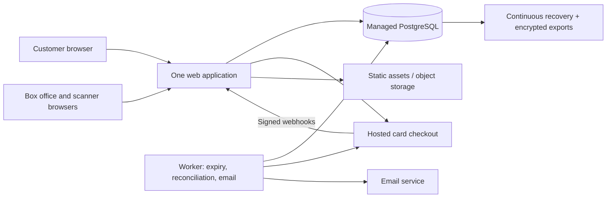

# Community theater ticketing design

Use one web application, managed PostgreSQL, a small worker, hosted card checkout, and browser-based door scanning.
Budget US$80–100/month before card fees, tax, volunteer time, and temporary recovery infrastructure.
The main correctness risk is releasing seats while a payment outcome is unknown; those seats must remain reserved.
This budget supports recovery, not guaranteed zero loss or uninterrupted service; validate recovery before launch.
Confirm seat identities, ticket format, payment integration, and retention promises before implementation.

## 1. Requirements and numbers

Confirmed defaults: one fixed 300-seat venue; 60 performances/year; 1,000 opening-minute visitors including 300 active seat selectors; Australia/AUD; hosted card checkout; guest purchases; 10-minute holds; 8 seats/order maximum. Adult/concession pricing, staff-managed accessible seats, comps, shared box-office inventory, full-order refunds, and no exchanges or passes. Three scanning phones, internet/hotspot, printable outage list. US$100/month excluding card fees, one technical volunteer, no 24-hour support. Stop sales before risking double sales; aim to recover within one hour.

Sizing assumptions: all performances sell out; 2 seats/order; 3 hold attempts/order; 5 sale openings/month; 300 active shoppers remain for an hour; one performance opens at a time. Simultaneous releases multiply demand. Store timestamps in UTC, display Australia/Melbourne; store prices as integer AUD cents. Freeze prices in order items.

### Traffic

60 × 300 = **18,000 seats/year** and 9,000 orders/year: about 49 seats and 25 orders/day. Size for release-time contention, not the daily average.

| Operation | Average during relevant busy period | Design peak | Annual calendar average |
|---|---:|---:|---:|
| Page/map reads | (1,000 + 300 × 3,600/5)/3,600 = 60.3 requests/s per sale hour | 1,000/60 + 300/5 = 76.7/s; test 200/s bursts | 13.02M/31.536M seconds = 0.413/s |
| Hold transactions | 150 orders × 3 /3,600 = 0.125/s | 300 shoppers/10 seconds = 30/s | 27,000/year = 0.00086/s |
| Checkout creation: reads and writes | 150/3,600 = 0.042/s | 150/30 seconds = 5/s | 9,000/year = 0.00029/s |
| Payment finalization writes | 150/3,600 = 0.042/s | 5/s; test 10 webhook deliveries/s with retries | 9,000/year = 0.00029/s |
| Admission lookup and write | 300/1,800 seconds = 0.167/s | 3 phones/2 seconds = 1.5/s; test 3/s | 18,000/year = 0.00057/s |
| Refund/admin writes | Assume 2% refunds: 180/year | Test 1/s including scan races | 180/31.536M = 0.000006/s |

A two-seat hold changes roughly 6 rows (order, items, inventory and request record): 30 successful holds/s means approximately 180 row changes/s. A paid order changes approximately 8 rows, or 40/s at peak. These are benchmark targets, not measured capacity guarantees.

Map polling every 5 seconds with jitter avoids per-change broadcast fan-out. Pause background tabs; stop when sale closes. A 10 KB snapshot × 216,000 polls/sale ≈ 2.16 GB/sale, or 10.8 GB/month. Static assets: 5,000 visits × 500 KB = 2.5 GB/month. Allow 15 GB/month total initially. One order sends one email with roughly two tickets: 750 emails/month; allow 1,500 with resends.

### Storage

| Data type | Annual generated volume |
|---|---:|
| Performance-seat inventory | 18,000 × 0.5 KB = 9 MB |
| Orders/items/payment references | 9,000 × 4 KB = 36 MB |
| Tickets/admissions | 18,000 × 1 KB = 18 MB |
| Hold records | 27,000 × 1 KB = 27 MB; prune abandoned records after 30 days |
| Payment receipts and audit events | 90,000 × 2 KB = 180 MB |
| Jobs and idempotency records | Allow 50,000 × 1 KB = 50 MB; prune completed work |
| Posters, in object storage | 60 × 2 MB = 120 MB |
| Logs | 10 MB/day × 365 = 3.65 GB generated; 14-day live window = 140 MB |

About 320 MB/year of raw database data before pruning, or about 1 GB/year allowing 3× for indexes/overhead. Start with at least 5 GB, alert at 70% full. Generate printable tickets on demand. Thirty daily exports of a 1 GB database need up to 30 GB before compression, separately from continuous backups.

### Monthly cost (USD)

| Item | Budget |
|---|---:|
| Always-on web service, around 1 CPU/2 GB | $25 |
| Small always-on worker | $7 |
| Paid managed PostgreSQL with continuous recovery and disk | $25–35 allowance |
| Transactional email | $0–10 allowance |
| Storage, backups, domain, monitoring, bandwidth | $10–15 allowance |
| Total | **$67–92; plan for $80–100** |

Render is a concrete candidate; published web/worker rates include $25 and $7 sizes. Other figures are procurement allowances, not verified plan quotes. Verify regional availability, DB performance, team access, and final account pricing before purchase. Keep app/worker/database in one region. [Render pricing](https://render.com/pricing).

Card fees remain: Stripe Australia lists domestic online cards at 1.7% + A$0.30. At an illustrative A$30/seat, a two-seat order costs 60 × 0.017 + 0.30 = A$1.32; 750 orders/month costs **A$990/month**. International cards and other fees differ. [Stripe Australia pricing](https://stripe.com/au/pricing). This removes ticket-platform charges, not card-processing costs. Development, phones, hotspot and maintenance are outside the hosting budget.

## 2. Architecture



Use the volunteer's familiar framework; Django is a reasonable default. One repository/image, separate web and worker entry points. Durable jobs live in PostgreSQL. Start with bounded pools of 10 web and 3 worker connections. No Redis, broker, microservices, or native phone application.

Public seat snapshots may use a 1-second process cache; they are advisory. The database alone grants seats. Add a keyboard-accessible seat list, clear labels, hold countdown, and states distinguishable without color. Prices, opening times and accessible-seat restrictions are enforced server-side.

## 3. Data model

| Table | Main fields and invariants |
|---|---|
| `layout_version`, `seat` | Immutable layout version, seat ID, row/number, coordinates, accessibility; unique label within version |
| `performance` | UUID, layout version, start/sale times, sale state |
| `performance_seat` | PK `(performance_id, seat_id)`; AVAILABLE/HELD/SOLD/BLOCKED; owner order; state/owner CHECK constraints |
| `order`, `order_item` | UUID, buyer email, state, deadline, total/currency; immutable seat/price snapshots; hashed guest access token |
| `payment_attempt` | Order, unique provider session/payment IDs, stable creation key, state; one active attempt/order |
| `ticket` | UUID, item, token hash, encrypted token for resend, validity, admission time; unique token hash; partial UNIQUE performance/seat where valid |
| `request_result` | UNIQUE actor scope + idempotency key, input hash, saved response |
| `payment_event`, `refund` | Unique provider IDs, durable processing state and refund request key |
| `job`, `audit_event` | Deduplication key, lease/retry timing; staff actor, action and time |

Enforce seat membership in the performance's frozen layout when creating inventory. Historical items and revoked tickets survive refunds/resale. Never delete paid order history.

Hot path:

```sql
BEGIN;
-- Insert/check scoped request-id record.
SELECT seat_id, state, owner_order_id
FROM performance_seat
WHERE performance_id = :performance
  AND seat_id = ANY(:distinct_requested_seats)
ORDER BY seat_id
FOR UPDATE;
-- Check exact requested count (1..8), ALL AVAILABLE,
-- sale opening, access restrictions, and server prices.
-- Insert order/items; mark ALL selected seats HELD with owner.
-- Save response; any failure rolls back the entire group.
COMMIT;
```

The composite primary key serves seat acquisition and full-map reads. Add order index `(state, hold_until)`, partial runnable-job index `(run_after)`, and ticket index `(performance_id, admitted_at)`. Row locks prevent concurrent writers from taking the same seats. [PostgreSQL locking](https://www.postgresql.org/docs/17/explicit-locking.html).

Existing-order operations lock order first, then seats in seat-ID order, then tickets. Expiry, finalization, refunds and admission follow that order. Bound lock waits and retry safely. Never call a provider while holding DB locks. **A past deadline does not itself make a held seat available.**

## 4. Key flows

### Hold and payment: critical path

1. `POST /holds` reserves the whole group atomically and returns guest authorization plus a database-time deadline. Ten minutes includes checkout, with no refresh extension. Limit one live hold per guest session and eight seats/order; rate-limit abuse without blocking all users on a shared IP.
2. Checkout validates the live hold and commits a CREATING payment attempt before calling Stripe. Create one card-only hosted Checkout Session with a stable idempotency key. Include order/performance/seat IDs and price snapshots in compact metadata for recovery. Save its ID before returning its URL. An ambiguous timeout must recover this same attempt, never create a second payable session. Disable abandoned-session recovery links.
3. Every five seconds, the worker checks deadlines. With no payment attempt, release the hold transactionally. Otherwise mark cancellation pending, recover any in-flight creation, and explicitly expire the provider session. **Release seats only after confirmed expired/unpaid status.** Paid completion wins the race and is fulfilled; processing/unknown outcomes retain seats. Stripe supports explicit expiry of open sessions. [Expire Checkout Session](https://docs.stripe.com/api/checkout/sessions/expire).
4. The ten-minute deadline is a cancellation target, not guaranteed instant resale. Do not assume hosted checkout's automatic expiry can be configured to match it. Under processor failure, display verification pending, retain inventory, reconcile every minute, alert after two minutes unresolved, and escalate after fifteen minutes. Do not release by age alone.
5. Verify webhook signatures on the raw request. Persist event before acknowledging; return an error if persistence fails. The worker retrieves payment state, validates session/order, amount and currency, then locks order/seats. Atomically mark SOLD/PAID, create one ticket per seat and enqueue email. Unique event IDs plus idempotent order transitions defeat duplicate/out-of-order delivery. The success redirect displays server status only. [Stripe fulfillment guidance](https://github.com/stripe/ai/blob/main/skills/stripe-best-practices/references/payments.md).
6. If a paid order unexpectedly lacks its owned seats, quarantine and alert, then refund idempotently; never allocate someone else's seats. This is incident recovery, not a normal timeout path.

Provider operations are at least once with idempotent effects. Worker jobs have renewable leases, backoff, capped automated retries and a visible failed-work list. Financial reconciliation continues until terminal or staff-resolved. Never recreate an unresolved payment after provider idempotency retention expires without investigation.

### Delivery and administration

The confirmation page and emailed secret order link provide printable tickets. Email is asynchronous; delivery failure cannot undo a sale. Retry ten times over 24 hours then alert staff; duplicate emails carry the same tickets. Guest/order pages use no-store caching, no third-party analytics, and no referrer leakage.

Managers schedule shows, block seats, issue audited comps, resend/reissue tickets and refund orders. Box-office paid sales use the same inventory/checkout via a customer-facing device or payment link; cash and separate terminal integration are excluded initially. A resumable per-order job handles show cancellation refunds.

Refunds lock order/tickets, reject already-admitted orders, mark refund pending and block scanning while retaining seats. Submit an idempotent refund. Confirmed success revokes tickets and releases seats if sales remain open. Unknown outcomes keep seats reserved; confirmed failure restores validity and alerts staff. Refund and admission serialize on the same order lock.

### Admission and outage procedure

QR payload: `theater:v1:<random 256-bit bearer token>`, no personal data. Store token hash for lookup and encrypted token for resend. A screenshot can be copied; first valid admission wins. Scanner POST requires a staff login restricted to the selected performance. Lock order, then conditionally mark a valid/unscanned ticket admitted. Save request ID, scanner identity and timestamp. Same-request retry returns its original outcome; another scan returns duplicate with first-admission details. Revoked/wrong-performance tickets are rejected.

Three connected phones share one admission record. A disconnected scanner must not show an unverified green success. Before doors open, close online sales, resolve pending payments, freeze ordinary refunds/comps and print a timestamped final manifest. A manager records any later changes on it.

On total outage, suspend all scanners and use **one staffed master paper checklist**, marking each seat once. Never distribute independent duplicate checklists. Handle missing names/payment claims at the box office. After recovery, enter paper admissions before resuming scanners. This trades speed for consistency; independent offline phone scanning is excluded.

## 5. Data protection

Targets: **99.5% monthly availability** (about 3.6 hours downtime/month), **one-hour recovery during staffed sale/event periods**, p95 local API latency under 500 ms at design load. These are engineering targets, not single-server or volunteer guarantees. RPO is the possible data-loss window; RTO is recovery duration.

| Data type | Cost to lose it | RPO target | Mechanism |
|---|---|---|---|
| Paid orders, seats, tickets, refunds | Charged customer without booking; duplicate resale | ≤15-minute DB loss; reconstruct paid orders before reopening | Continuous PITR, provider metadata/reconciliation, encrypted daily exports |
| Comps, staff changes, admissions | Incorrect entry/entitlement, absent from payment records | ≤15 minutes DB; final manifest at doors | PITR, audit events and controlled paper ledger; residual loss risk |
| Unpaid holds | Customer retries | Up to ten minutes | Expire after recovery; preserve uncertain payment attempts |
| Layout/configuration/posters | Manual re-entry | 24 hours | Versioned configuration and daily export/object backup |
| Jobs/email state | Delayed or duplicate notification | ≤15 minutes | PITR and recreation from orders |
| Logs | Lost diagnostics | 24 hours | External logs; no card data or tokens |

Render documents continuous backup for paid databases, three-day Hobby recovery history, and inability to restore to within ten minutes of current time. This does not guarantee a 15-minute RPO: verify actual recoverable points and restore duration. [Render recovery documentation](https://render.com/docs/postgresql-backups). **Strict zero-loss recovery is not met by this design.** Accept the residual risk or fund stronger synchronous durability and independent journaling before launch.

After restore, keep sales/scanning disabled. Reconcile payments/refunds since the restore point, including sessions created during downtime; rebuild missing orders/tickets, resolve any seat conflicts, merge paper admissions, then reopen. Provider records cannot restore every comp or admission. Drill before launch and quarterly; monitor recovery availability daily. Keep encrypted daily exports for 30 days in a separate storage account.

Use HTTPS, managed secrets, private DB access, staff MFA and manager/box-office/scanner roles; secure guest cookies, CSRF defense and signed webhooks. Never store card numbers or CVCs. Back up token encryption keys separately; audit overrides and ticket reissues, which invalidate old tokens. Give a second committee member documented recovery access to theater-owned accounts.

Proposed retention: customer contact/access tokens 12 months after performance; financial ledger without unnecessary contact details seven years; logs 14 days; completed jobs 30 days. These are proposed product policies, not legal requirements. Review before publication; backups expire after deletion, and restored data must have deletions reapplied.

## 6. Decisions

| Choice | Alternative | Why | Hard to reverse? |
|---|---|---|---|
| Immutable seat/layout IDs, separate inventory per performance | Mutable seat labels | Preserve historical bookings | **Yes:** migrate inventory and ticket history |
| Versioned opaque QR and stable guest ticket URLs | Signed offline tickets/accounts | Simple revocation and guest checkout | **Yes:** keep old formats working or reissue tickets |
| Stripe hosted checkout and provider IDs | Another provider/embedded form | Less card-handling work | **Yes:** maintain historical refund/payment integration |
| Retention policy above | Different retention | Minimize personal data | **Yes once promised:** deletion is irreversible and promises constrain migration |
| PostgreSQL authority | Distributed reservations | Transactional seat ownership at modest scale | No external contract; backend can migrate |
| One app/worker on managed hosting | Microservices | Volunteer-friendly operations | No |
| Ten-minute hold/five-second polling | Other intervals/push | Simple first version | No: configuration |
| Connected scans plus master paper list | Offline multi-device scanning | Prevent disconnected duplicate acceptance | No, but offline mode needs a new operational design |

No public integration API is promised. IDs alone are never authorization. Maintain issued-ticket format/link compatibility through ticket lifetime.

## 7. Failure walk

| Failure | Behavior and recovery |
|---|---|
| Crash during reservation | Rollback all seats; committed-but-lost response recovered by request key |
| Crash after external session creation | Durable attempt and stable key recover same session; keep inventory |
| Payment completes during expiry | Check terminal provider state; fulfill paid order, never release on deadline alone |
| Crash after sale before email | Ticket and email job commit together; retry leased work |
| Double submission/webhook/scan/refund | Unique keys and conditional transitions yield one business effect |
| Processor slow/down | Bound call time, display pending, reconcile; pause new payments if necessary |
| Email outage | Tickets available on confirmation page; queued retries and staff resend |
| Database failure or older restore | Stop writes/scans; reconcile before reopening; paper admission fallback |
| Worker silently stops | External heartbeat alarm after 60 seconds during sale; overdue-job dashboard and process restart |
| App/DB host outage | Accepted single-instance outage; redeploy/restore runbook and external backups |
| Domain expiry/TLS/DNS failure | Auto-renew, current card, secondary owner, 30/14/7-day alerts, external HTTPS checks |
| Volunteer unavailable/account locked | Theater-owned credentials, backup custodian, trained event lead |
| Venue internet loss | Hotspot, then one master paper list; suspend scanners together |
| Hold abuse | Eight-seat limit, one live hold/session, rate limits; challenge suspicious behavior |

Implementation acceptance tests: 1,000 opening visitors, 300 active shoppers, overlapping eight-seat requests, two buyers for the last seat, payment/expiry races, duplicated/reordered webhooks, crash after payment success, refund versus scan, same QR on three phones. Require no duplicate active allocation/admission. Benchmark p95 latency and contention on the purchased tier. Run a real low-value purchase/refund, email resend, backup restore, and timed paper-door drill. These tests have not been executed: this deliverable is a design, not application code.

## 8. Not building yet

| Addition | Numeric trigger to revisit |
|---|---|
| Larger DB/extra web replica | p95 API >500 ms or DB CPU >70% for five minutes after tuning |
| Waiting room | >2,000 active shoppers or >100 hold attempts/s for 60 seconds, or >1% overload errors |
| Shared cache/server push | >1,000 map viewers (200 polls/s) for five minutes or >50 GB/month bandwidth |
| Dedicated queue | >50 jobs/s for ten minutes or oldest ready job >60 seconds after worker tuning |
| HA DB/second region | Required availability ≥99.9%, recovery requirement <15 minutes, or restore drill >60 minutes |
| Offline scanning | Two connectivity failures/season or paper drill >15 minutes for 300 guests; resolve duplicate-entry policy first |
| Terminal/native/cash workflow | >30 staff-assisted paid orders/performance for three performances |

## 9. Open risks

- Zero-loss recovery is not established. Confirm the residual loss window, particularly for comps/admissions, or revise the budget. Backup existence alone is not proof of recoverability.
- One-hour recovery needs a reachable operator. Name sale/event operators and a backup custodian before launch.
- Hosting/team access and database performance may push cost over US$100. Verify quote and benchmark; retain continuous backups.
- The map can be stale when someone else takes a seat. Return a clear atomic conflict and let customers select again.
- Ten-minute cancellation may finish late during processor trouble. Test authentication and completion races with the pinned payment API version.
- Door fallback depends on final reconciliation, one master checklist, and staff coordinating the mode switch.
- Confirm exact accessibility rules, refund terms and retention before publishing promises; test camera behavior on actual volunteer phones and keyboard map navigation.

Prepared 24 October 2026. Linked vendor facts support the proposal; costs, traffic and reliability targets remain engineering estimates. No infrastructure or application code has been deployed.
